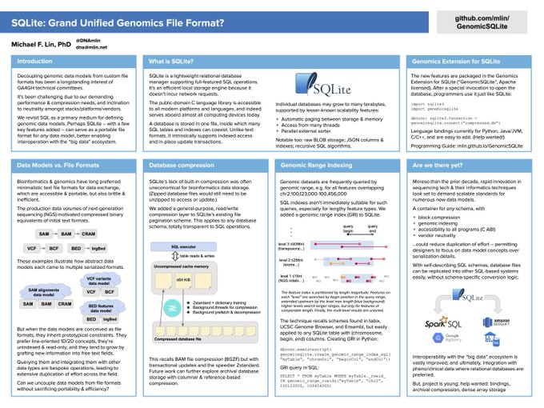

# Genomics Extension for SQLite

### ("GenomicSQLite")

[https://github.com/mlin/GenomicSQLite](https://github.com/mlin/GenomicSQLite)

This [SQLite3 loadable extension](https://www.sqlite.org/loadext.html) supports applications in genome bioinformatics by adding:

* genomic range indexing for overlap queries & joins
* in-SQL utility functions, e.g. reverse-complement DNA, parse "chr1:2,345-6,789"
* automatic streaming storage compression
* reading directly from HTTP(S) URLs
* pre-tuned settings for "big data"

This November 2021 poster discusses the context and long-run ambitions:

[](GenomeInformatics2021Poster.pdf)

Our **[Colab notebook](https://colab.research.google.com/drive/1BND1nYHDg9DLsw5buvaB30BpH_GoYbit)** demonstrates key features with Python, one of several language bindings.

**USE AT YOUR OWN RISK:** The extension makes fundamental changes to the database storage layer. While designed to preserve ACID transaction safety, it's young and unlikely to have zero bugs. This project is not associated with the SQLite developers.

## SQLite requirements

The SQLite library linked into your application must be at least version 3.31.0 (2020 vintage) and support [loadable extensions](https://www.sqlite.org/loadext.html). Check the version with `SELECT sqlite_version()` in your program.

The **macOS** default SQLite unfortunately disables extension loading. Homebrew and conda provide compatible SQLite packages; install one and configure your build system (if applicable) to use it.

On other platforms, if SQLite is too old or lacks extension support, upgrade it with your package manager or see [How To Compile SQLite](https://www.sqlite.org/howtocompile.html). As a last resort for GNU/Linux, our [GitHub Releases](https://github.com/mlin/GenomicSQLite/releases) attach a widely-compatible `libsqlite3.so.0`.

## Installation

It's usually easiest to obtain the extension as a pre-compiled shared library (GNU/Linux .so or macOS .dylib), either installed with a package manager, or downloaded from [GitHub Releases](https://github.com/mlin/GenomicSQLite/releases).

=== "Python"
    ``` bash
    pip3 install [--user|--system] genomicsqlite
    # -or-
    conda install -c mlin genomicsqlite
    ```
    On Ubuntu 24.04, the system Python (3.12.3) may emit a harmless `DeprecationWarning` about `?NNN` parameter binding. This CPython bug was fixed in 3.12.4.

    The package loads a bundled shared library by default. To override the bundled file, set environment variable `LIBGENOMICSQLITE` to a filename.

=== "JVM"
    Add entries like the following to your Maven `pom.xml`:
    ```xml
    <repositories>
      <repository>
        <id>genomicsqlite-jdbc</id>
        <url>https://raw.githubusercontent.com/wiki/mlin/GenomicSQLite/mvn-repo/</url>
      </repository>
    </repositories>

    <dependencies>
      <dependency>
        <groupId>net.mlin</groupId>
        <artifactId>genomicsqlite-jdbc</artifactId>
        <version>vX.Y.Z</version>
      </dependency>
    </dependencies>
    ```

    Or to your `build.gradle`:
    ```groovy
    repositories {
      maven {
        url 'https://raw.githubusercontent.com/wiki/mlin/GenomicSQLite/mvn-repo/'
      }
    }

    dependencies {
      compile group: 'net.mlin', name: 'genomicsqlite-jdbc', version: 'vX.Y.Z'
    }
    ```

    Alternatively, download the JAR from [GitHub Releases](https://github.com/mlin/GenomicSQLite/releases) and place it in your classpath, along with [sqlite-jdbc](https://github.com/xerial/sqlite-jdbc)'s JAR which is also required. The GenomicSQLite JAR loads a bundled shared library by default. To override the bundled file, set environment variable `LIBGENOMICSQLITE` to a filename. sqlite-jdbc similarly bundles a SQLite library.

    To bundle GenomicSQLite and sqlite-jdbc inside an "Uber JAR" for your application, you may need to enable the [ServicesResourceTransformer for Maven Shade](https://maven.apache.org/plugins/maven-shade-plugin/examples/resource-transformers.html#ServicesResourceTransformer) or [mergeServiceFiles() for Gradle Shadow](https://stackoverflow.com/questions/32887966/shadow-plugin-gradle-what-does-mergeservicefiles-do), to ensure the JDBC drivers will be registered automatically when the "Uber JAR" loads.

    Recommendation: *also* install the Python package, which includes a useful command-line shell and other tools.

=== "Rust"
    Add to your project's `Cargo.toml`:

    ```toml
    [dependencies.genomicsqlite]
    version = "^0"
    ```

    Building with the crate will include a platform-appropriate shared library file within your compilation unit, to be extracted & loaded at runtime. To disable this, add `default-features = false` to the dependencies entry and at runtime, set environment variable `LIBGENOMICSQLITE` to a filename or place the library file somewhere it'll be found by `dlopen("libgenomicsqlite")`.

    To make `rusqlite` use an SQLite library other than the system's default, set `SQLITE3_LIB_DIR` and `SQLITE3_INCLUDE_DIR` to the `lib` and `include` directories where the library is installed.

    Recommendation: *also* install the Python package, which includes a useful command-line shell and other tools.

=== "C/C++"
    Download zip of shared library and `genomicsqlite.h` from [GitHub Releases](https://github.com/mlin/GenomicSQLite/releases). Build your program with them, and also ensure the dynamic linker will find the shared library at runtime, by either: (1) installing it in a system or user lib directory & refreshing cache, (2) setting `LD_LIBRARY_PATH` environment variable, (3) building with `-rpath`.

    GNU/Linux: to link the prebuilt `libgenomicsqlite.so` distributed from our GitHub Releases, you
    may have to compile your source with `CXXFLAGS=-D_GLIBCXX_USE_CXX11_ABI=0`. This is because the
    library is built against an old libstdc++ version to improve runtime compatibility. The
    function of this flag is explained in the libstdc++ docs on
    [Dual ABI](https://gcc.gnu.org/onlinedocs/libstdc++/manual/using_dual_abi.html). If you build
    `libgenomicsqlite.so` from source, then the flag will not be needed.

    Recommendation: *also* install the Python package, which includes a useful command-line shell and other tools.

See our [GitHub README](https://github.com/mlin/GenomicSQLite) for the source build procedure, if needed.

We welcome community contributions to the available language bindings; see the [Language Bindings Guide](bindings.md) if interested.

## Smoke test

We recommend trying our "smoke test" script to quickly verify your local system's compatibility. It requires the Python package installed per the instructions above.

```bash
wget -nv -O - https://raw.githubusercontent.com/mlin/GenomicSQLite/release/test/genomicsqlite_smoke_test.py \
    | python3 -
```

Even if you're not planning to use Python, this test's detailed logs may be useful to diagnose general problems loading the extension.

## Use cases

The extension makes SQLite an efficient foundation for:

1. Integrative genomics data warehouse
    * BED, GFF/GTF, FASTA, FASTQ, SAM, VCF, ...
    * One file, zero administration, portable between platforms and languages
2. Slicing & basic analysis with indexed SQL queries, joins, & aggregations
3. Transactional storage engine for API services, incremental reanalysis, real-time basecalling & metagenomics, ...
4. Experimental new data models, before dedicated storage format & tooling are warranted, if ever.

### Contraindications

1. Huge numerical arrays: see [HDF5](https://www.hdfgroup.org/solutions/hdf5/), [Zarr](https://zarr.readthedocs.io/en/stable/), [Parquet](https://parquet.apache.org/), [Arrow](https://arrow.apache.org/), [TileDB](https://github.com/TileDB-Inc/TileDB). <small>SQLite's [BLOB I/O](https://www.sqlite.org/c3ref/blob_open.html) leaves the door open for mash-ups!</small>
2. Parallel SQL analytics / OLAP: see [Spark](https://spark.apache.org/), [DuckDB](https://duckdb.org/), many commercial products. <small>(Some bases can be covered with a sharding harness for a pool of threads with their own SQLite connections...)</small>
3. Streaming: SQLite storage relies on randomly reading & writing throughout the database file.

**Proceed to the [Programming Guide](guide_db.md) section to get started building applications.**
